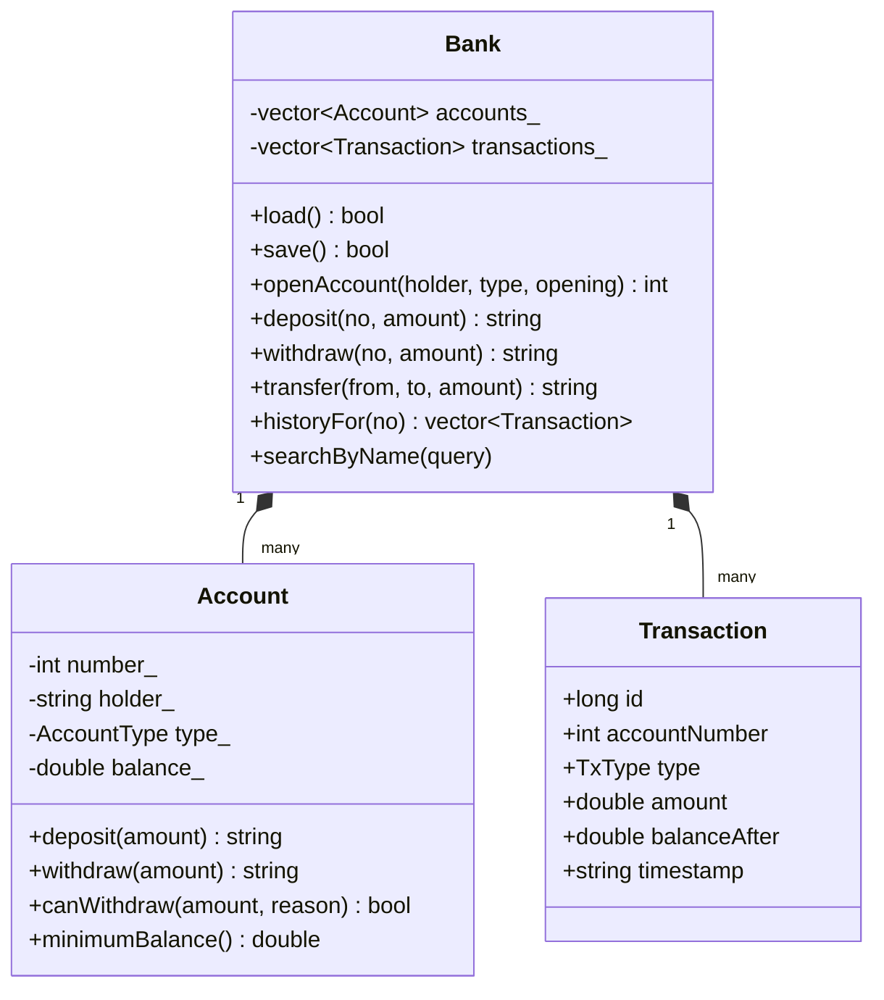
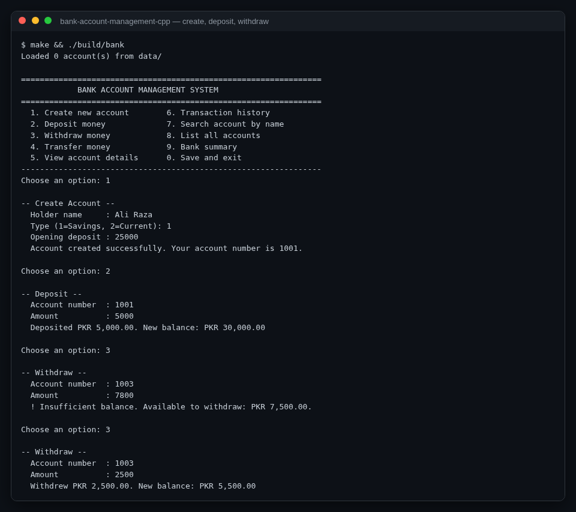
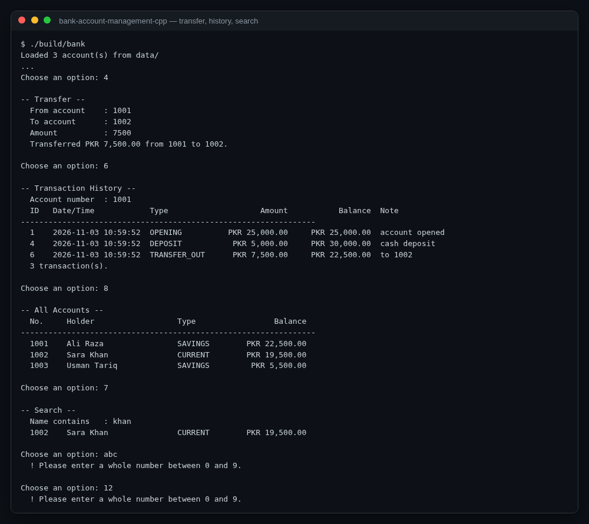
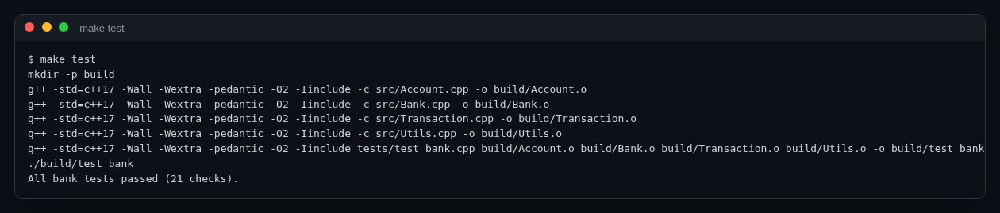

# Bank Account Management System (C++)

A console banking application written in modern C++17 — open accounts, deposit, withdraw, transfer between accounts and keep a full transaction history that survives restarts through CSV files.


## Features

- **Create accounts** — Savings or Current, auto-generated account numbers starting at `1001`
- **Deposit / Withdraw** with validation:
  - amounts must be positive (rounded to 2 decimals)
  - Savings accounts must keep a minimum balance of **PKR 500**
  - single-withdrawal limit of **PKR 100,000**
- **Transfer** between two accounts — checked first, then both sides applied, so a failed transfer changes nothing
- **Transaction history** per account (opening, deposit, withdrawal, transfer in/out) with timestamps and running balance
- **Search** accounts by (partial, case-insensitive) holder name
- **List all accounts** and a small bank summary
- **File persistence** — `data/accounts.csv` and `data/transactions.csv`, saved after every operation
- **Robust input** — the menu keeps asking until the input is valid, and exits cleanly on end of input (Ctrl+D)
- **Unit tests** — `make test` runs a self-checking test program (no external framework)

## Tech Stack

- C++17 (STL: `vector`, `string`, `fstream`, `sstream`, `iomanip`)
- GNU Make, g++ (`-Wall -Wextra -pedantic`, zero warnings)

## Project Structure

```
bank-account-management-cpp/
├── include/
│   ├── Account.h        # Account class (encapsulated balance, validation rules)
│   ├── Bank.h           # Bank: owns accounts + transactions, file I/O
│   ├── Transaction.h    # Transaction record + CSV (de)serialisation
│   └── Utils.h          # input helpers, money formatting, CSV split
├── src/
│   ├── Account.cpp
│   ├── Bank.cpp
│   ├── Transaction.cpp
│   ├── Utils.cpp
│   └── main.cpp         # menu / user interface
├── tests/
│   └── test_bank.cpp    # assertions for deposits, limits, transfers, persistence
├── data/                # CSV files are created here at runtime
├── screenshots/
└── Makefile
```

## Design



Operations return an empty string on success or a human-readable error message, which keeps the UI code (`main.cpp`) free of business rules.

## How to Run

Requirements: `g++` with C++17 support and `make` (Linux, macOS, or Windows with MinGW/WSL).

```bash
git clone https://github.com/Mo-aini/bank-account-management-cpp.git
cd bank-account-management-cpp
make            # builds build/bank
make run        # runs the app, data stored in ./data
make test       # builds and runs the unit tests
```

Without make:

```bash
g++ -std=c++17 -Wall -Iinclude src/*.cpp -o bank
./bank
```

You can also replay a scripted session (input is echoed when piped):

```bash
printf "1\nAli Raza\n1\n25000\n8\n0\n" | ./build/bank
```

## Sample Output / Screenshots

Creating accounts, depositing, and a rejected withdrawal (Savings minimum balance rule):



Transfer, transaction history, account list, search, and input validation:



Unit tests:



Example of the saved files after the session above:

`data/accounts.csv`
```csv
number,holder,type,balance,created_at
1001,Ali Raza,SAVINGS,22500.00,2026-11-03 10:59:52
1002,Sara Khan,CURRENT,19500.00,2026-11-03 10:59:52
1003,Usman Tariq,SAVINGS,5500.00,2026-11-03 10:59:52
```

`data/transactions.csv`
```csv
id,account,type,amount,balance_after,timestamp,note
1,1001,OPENING,25000.00,25000.00,2026-11-03 10:59:52,account opened
2,1002,OPENING,12000.00,12000.00,2026-11-03 10:59:52,account opened
3,1003,OPENING,8000.00,8000.00,2026-11-03 10:59:52,account opened
4,1001,DEPOSIT,5000.00,30000.00,2026-11-03 10:59:52,cash deposit
5,1003,WITHDRAW,2500.00,5500.00,2026-11-03 10:59:52,cash withdrawal
6,1001,TRANSFER_OUT,7500.00,22500.00,2026-11-03 10:59:52,to 1002
7,1002,TRANSFER_IN,7500.00,19500.00,2026-11-03 10:59:52,from 1001
```

## Complexity Notes

| Operation | Time | Notes |
|---|---|---|
| Find account by number | O(n) | linear scan over `vector<Account>` |
| Search by name | O(n · m) | substring match, m = name length |
| Deposit / Withdraw | O(n) | dominated by the lookup |
| Transaction history | O(t) | t = total transactions |
| Load / Save | O(n + t) | one pass over each file |

A `std::unordered_map<int, size_t>` index would make lookups O(1) on average — a good next step if the number of accounts grows.

## What I Learned

- Encapsulation: the balance can only change through validated member functions
- Splitting a program into headers and source files, and building it with a Makefile
- Reading/writing structured data with `fstream` and CSV
- A real C++ pitfall: returning a reference into a `std::vector` is unsafe because `push_back` can reallocate — `openAccount` returns the account number instead
- Writing defensive console input (`std::getline` + `std::stoi` with full-string checks)

## Author

**Mohammed Emad ALaini** — BS Software Engineering, Superior University

## License

MIT — see [LICENSE](LICENSE).
